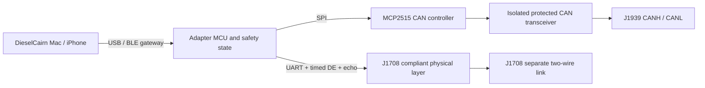

# Dual-link hardware architecture

The three host paths currently planned are STM32 plus external CAN controller, Arduino USB-CDC plus external CAN controller, and FT232H MPSSE plus external MCP2515. Add a separate J1708 front end and deterministic timing controller to each. An FT232H is not a real-time J1708 scheduler. A CAN HAT is not a J1708 interface.

The candidate Renesas ISL32455E requires datasheet/reference-circuit review; it is not a validated design choice. Check TI AN-915 and Renesas AN1990 before schematic work. J1708 loading/bias/filtering differs from CAN termination. Every hardware item stays bench-only until design review and safety validation pass.

