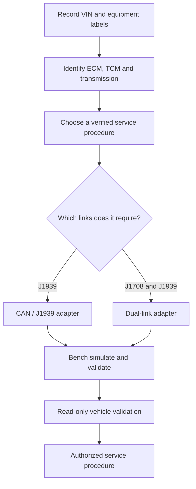

DieselCairn · Field Guide

# A practical bench for the PB305

Diagnostics, protocol simulation, and adapter development for a 2009 International RE300 school bus.

-   [**VEHICLE · PB305**](vehicle/identity.md)

    Factory school-bus model PB305, RE300 badge, MaxxForce DT, and owner-reported Allison 3000 Series 3000PTS. Verify the transmission nameplate; installed module identities are still to be collected.

-   [**PROTOCOLS · THREE LAYERS**](protocols/index.md)

    J1939 over classic CAN; J1708 physical/data link; J1587 messages over J1708. Each capture must retain its source and link.

-   [**BENCH · BEFORE VEHICLE**](bench/simulator.md)

    Software fixtures and planned physical simulator nodes have separate validation gates. No prototype is marked vehicle-ready.

-   [**EVIDENCE · SOURCE FIRST**](references.md)

    Procedures link to references. Generic standards and third-party reports do not establish the configuration of this PB305.

!!! info "Current status"
    The app can exercise labeled software fixtures. The J1708/J1587 physical simulator node and hardware-in-loop validation still need to be built. There is no validated ECM/TCM write path.

## Start with the service task

## Find the right guide

- **Vehicle Profile** covers target identity, records, service workflows, and diagnostics.
- **Protocols** explains frame/message boundaries and the cross-link programming sequence.
- **Bench Lab** documents simulator software, reusable tools, firmware, and adapter construction.
- **Flash Studio** defines supported input formats and the evidence required before programming can be considered.

!!! warning "Scope and safety"
    These pages describe project requirements, not approval to connect a prototype to the bus. The current prototypes are not vehicle-ready and do not implement an ECM/TCM write path. Vehicle connector wiring and installed module/calibration identities are unknown.

## Evidence labels

| Label | Meaning |
|---|---|
| **Verified source** | Directly supported by an official service document, vendor datasheet, or protocol reference linked here. |
| **Target unverified** | Standard behavior is known but not established on this specific PB305. |
| **Simulator fixture** | Synthetic software data for testing only. |
| **Bench validated** | Requires recorded physical adapter/simulator evidence. |
| **Vehicle validated** | Requires real bus capture and service evidence for this exact bus. No current feature has this status. |
