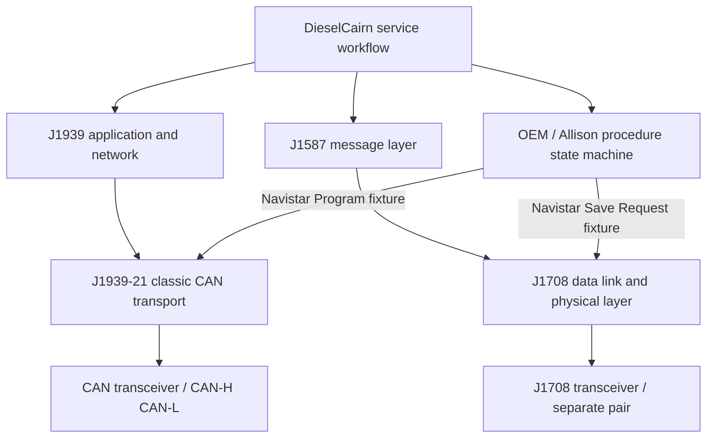

# Protocol map

J1939 and J1587 are not interchangeable encodings. J1587 travels on J1708; it is not a PGN and does not use CAN arbitration. Each physical link has its own capability, status, capture, adapter front end and fault injection controls. See [J1939/CAN](j1939.md), [J1708/J1587](j1708-j1587.md), and [cross-link workflow](programming-workflow.md).

