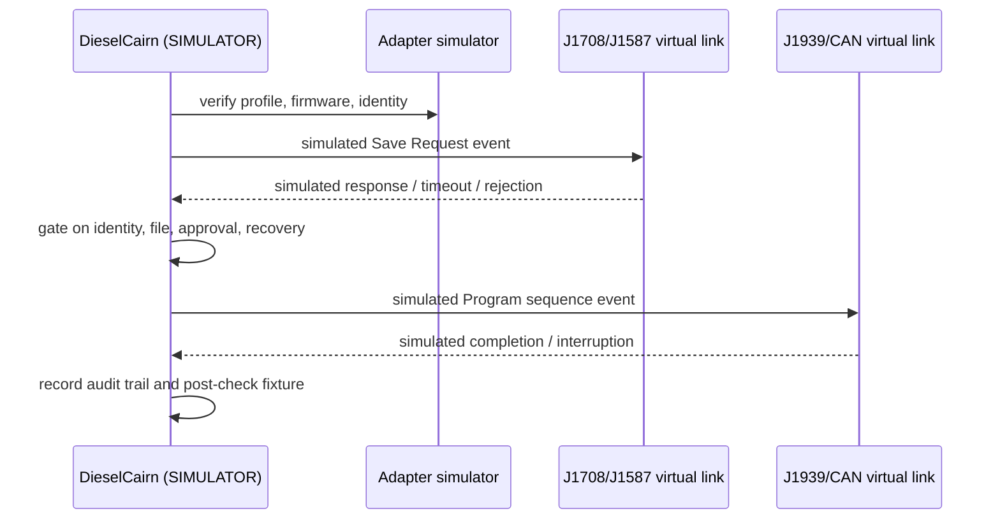

# Cross-link service workflow simulator

The target workflow described by Navistar IK2600282 is an important reason the simulator needs both J1708/J1587 and J1939. The bulletin says NavKal performs Save Request on J1708 and Program on J1939 for applicable 2007–09 MaxxForce engines. It does not publish a complete wire protocol or authorize a third-party implementation.

## Required simulator branches

- Correct two-link order and target identity.
- Wrong VIN/module/calibration or unrecognized engine family: stop before program state.
- Save Request timeout/rejection, J1708 disconnect, checksum/frame error or collision: no Program event.
- J1939 transport loss, bus-off, power brownout or device reset during simulated programming: surface failure, preserve journal and show recovery decision.
- Unknown file format, signature failure or missing authorization: stop and do not generate an executable image.
- Successful fixture path: test UI states and audit output only; label as a simulation result.

## Boundaries

This is an application sequence test, not an ECM/TCM emulator or NavKal/Allison DOC replacement. Do not reverse engineer authentication or bypass licensing. Live programming remains unavailable until exact target, authorized software/interface, package format, recovery, bench/HIL and service evidence are complete.

